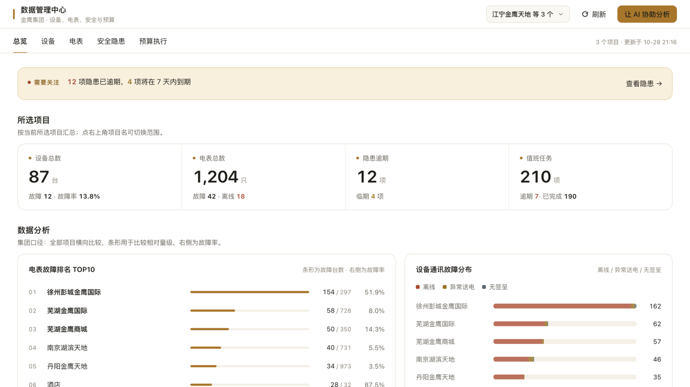
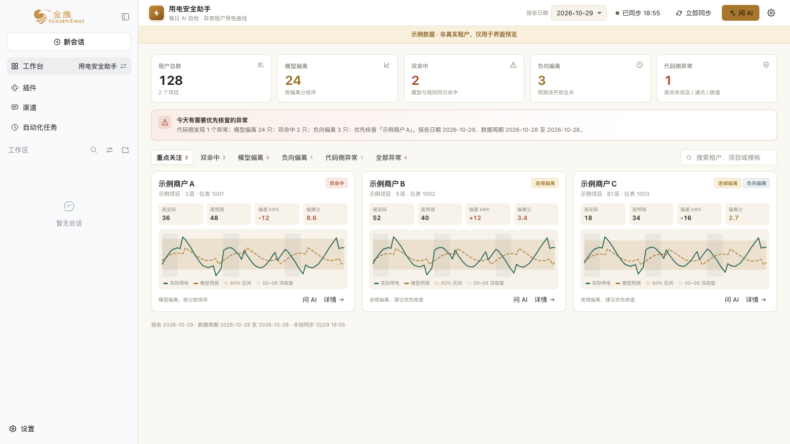
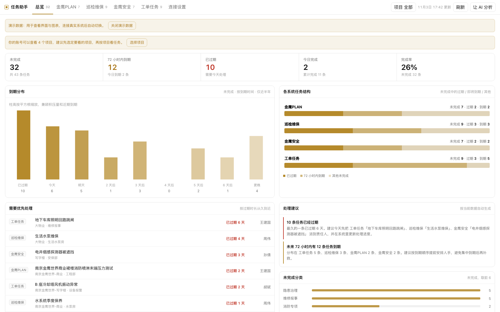
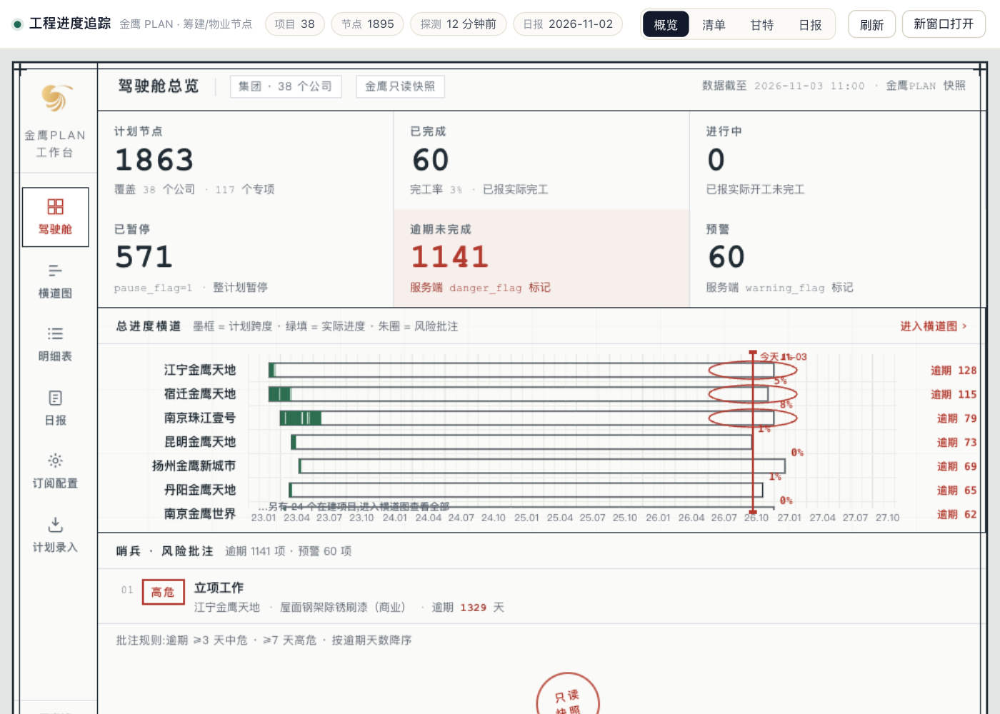
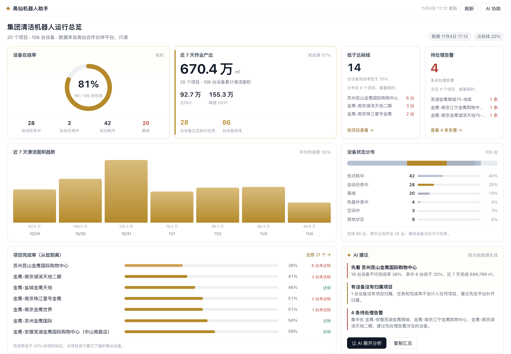

# 工作台包归档

`index.json` 是工作台市场目录。以下目录是五个已发布工作台的可安装包内容归档（从 `packages/<name>/*.tgz` 解包，版本与目录一致）：

| 目录 | 名称 | 版本 | 分类 | 安装包 |
|---|---|---|---|---|
| `ge-workbench-datacenter/` | 数据管理中心 | 0.4.0 | operations | `packages/ge-workbench-datacenter/ge-workbench-datacenter-0.4.0.tgz` |
| `ge-workbench-electric-safety/` | 用电安全助手 | 0.2.0 | operations | `packages/ge-workbench-electric-safety/ge-workbench-electric-safety-0.2.0.tgz` |
| `ge-workbench-task-assistant/` | 任务助手 | 0.6.6 | productivity | `packages/ge-workbench-task-assistant/ge-workbench-task-assistant-0.6.6.tgz` |
| `ge-workbench-engineering-progress/` | 工程进度追踪 | 0.1.3 | engineering | `packages/ge-workbench-engineering-progress/ge-workbench-engineering-progress-0.1.3.tgz` |
| `ge-workbench-robot-ops/` | 高仙机器人助手 | 0.3.4 | operations | `packages/ge-workbench-robot-ops/ge-workbench-robot-ops-0.3.4.tgz` |

- 每个目录内的 `ARCHIVE.json` 记录市场条目 ID、版本、安装包相对路径、sha256 与截图。
- 安装包与截图仍放在 `packages/<name>/`；市场安装走自托管的 github-release tgz，不依赖本目录。
- 本目录用于在仓库内直接查看和审计已发布包内容，不作为安装源。

## 预览

| 数据管理中心 | 用电安全助手 |
|---|---|
|  |  |

| 任务助手 | 工程进度追踪 |
|---|---|
|  |  |

| 高仙机器人助手 |
|---|
|  |