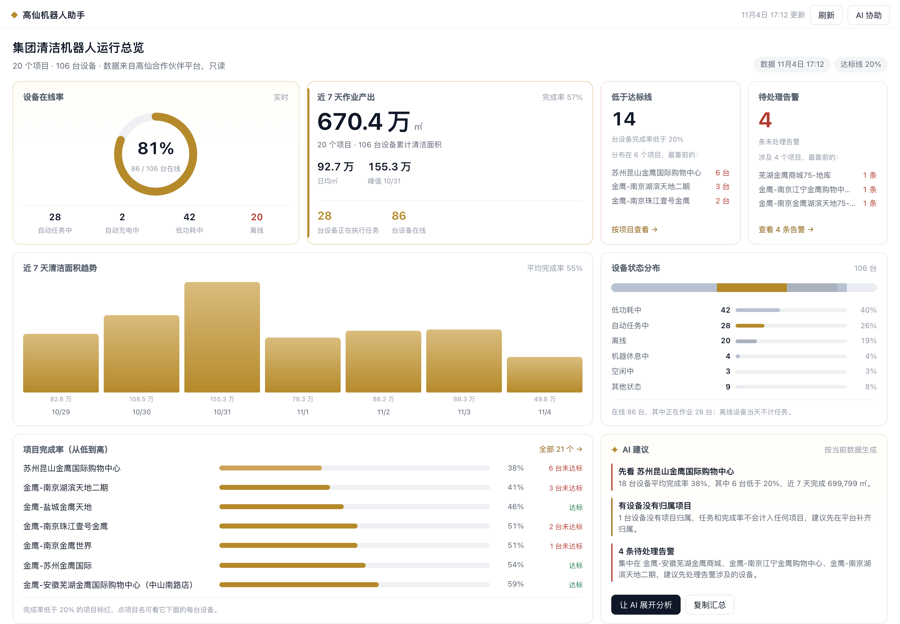

# 高仙机器人助手（Ge Workbench · Robot Ops）

在 金鹰 Agent 里查看高仙清洁机器人的运行情况：全集团总览 → 项目 → 单台设备，
业务内容占整页，需要分析时再打开 AI 对话。

> 开发者：颜政、张宸熙 · MIT



## 能做什么

- **集团总览**：首页是看板而不是清单。重点卡片是设备在线率（环形）和近 7 天作业产出，
  旁边是低于达标线、待处理告警两张风险卡；下面是近 7 天面积趋势、设备状态分布、
  项目完成率条形排行，以及按当前数据生成的 AI 建议。
- **项目排行**：按完成率、未达标台数、面积排序；点进去看该项目每台设备的状态与完成率。
- **单台设备**：近 7 天逐日清洁面积柱状图（颜色区分是否达标）、区间汇总、最近一周告警。
- **待处理告警**：首页告警卡直接进「待处理告警」页，按设备列出最近的告警标题、等级和时间，点卡片看该设备的任务趋势。
- **数据异常提示**：平台上没有归属项目的设备单列，避免任务缺口被漏掉。
- **状态口径**：设备状态用平台官方状态字典（230 自动任务中、380 低功耗中、170 导航中……），
  取不到字典时回退到常见状态；状态分布各段之和等于设备总数。

数据全部来自高仙机器人合作伙伴平台的**只读**查询接口，工作台不会下发任务、
修改排班或改动设备设置；机器人调度与下发留到二期。

## 怎么打开

安装并重启 金鹰 Agent 后，展开左侧栏，点击左上角「工作台」右侧的当前工作台名称，
选择「高仙机器人助手」。

首次使用会自动弹出高仙平台的浏览器登录窗口（工作台自带登录器，不要求先装高仙 MCP；账号密码不经过工作台）；
登录完成后会话保存在本机 `~/.robot-partner/session.json`，界面会自动刷新。登录窗口 10 分钟内有效，
没有会话时界面会给出「打开登录窗口」按钮，不会把空数据当成正常结果。

## 数据与配置

| 环境变量 | 说明 | 默认 |
|---|---|---|
| `ROBOT_PARTNER_SESSION_FILE` | 登录会话文件 | `~/.robot-partner/session.json` |
| `ROBOT_PARTNER_API_BASE` | 业务接口网关 | `https://bot.gs-robot.com` |
| `ROBOT_PARTNER_BROWSER_PATH` | 登录窗口用的 Chrome/Edge 路径 | 自动探测 |
| `ROBOT_PARTNER_HTTP_TIMEOUT` | 单次请求超时（毫秒） | `20000` |

快照缓存在 DSH 数据目录的 `robot-ops/snapshot.json`，默认 5 分钟内复用，
点「刷新」会强制重新取数；卸载工作台不会删除该缓存目录。

## 本机接口

服务端入口注册在 `/api/robot-ops/` 下，均为只读：

- `GET /api/robot-ops/status`：登录状态、数据时间、接口地址
- `GET /api/robot-ops/snapshot`：汇总快照（`?refresh=1` 强制刷新）
- `GET /api/robot-ops/device?sn=…`：单台设备的 7 天趋势与告警

## 开发

```bash
npm install
npm run build   # 构建 lib/client.js
npm test        # 汇总计算、趋势、状态分组、服务端接口、客户端注册与渲染
npm run check   # build + test
```

## 许可

MIT